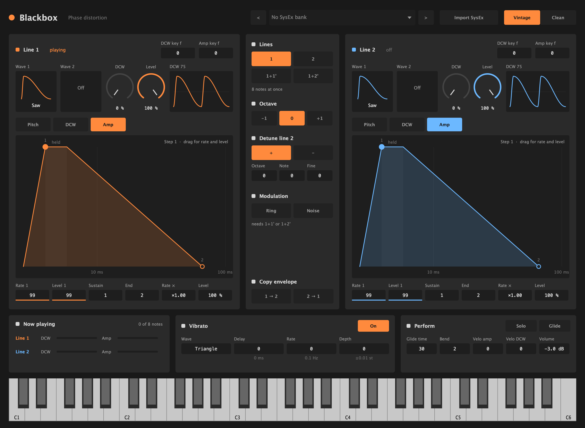

# Blackbox

A Casio CZ-101 in your DAW: the phase distortion synth rebuilt from how its sound chip works, with
every CZ tone setting and import of real CZ tones. A free VST3 and CLAP instrument plugin for
macOS.



Blackbox models the NEC/Casio uPD933 chip of the CZ-101 and CZ-1000. In **Vintage** mode it runs
the chip's own integer arithmetic at the chip's 40 kHz, and matches MAME's emulation of the chip
sample for sample. **Clean** mode plays the same shapes at a higher rate, with less aliasing.

- Both lines side by side, each with its two waves (the CZ's 8, including the resonance waves),
  DCW, key follow, a live picture of its wave, and 8-step Pitch, DCW and Amp envelopes you draw on a graph
- Line select 1, 2, 1+1' and 1+2', detune for line 2, ring and noise modulation, octave
- Vibrato with the CZ's four waves, delay, rate and depth
- Eight notes at once, as on a CZ-101 (four with two lines), or Solo with Glide
- Velocity for amp and DCW, as on the CZ-1 (a CZ-101 has none)
- Imports CZ-101, CZ-1000 and CZ-5000 tones and banks from SysEx files, and takes tones sent to it
  over MIDI from a real CZ or a librarian
- Additions to the CZ for each line: a fixed DCW the envelope adds to (like a filter's cutoff), a
  level, and for each envelope a speed (Rate ×) and depth (which can turn it upside down). Loading
  a CZ tone sets these back, so it plays as the CZ would.

Blackbox comes with an initial tone and no tone banks: import your own CZ `.syx` files.

## Download

Download **[Blackbox-Synth-0.5.0-macOS.zip](Blackbox-Synth-0.5.0-macOS.zip)** (or the newest zip
under [Releases](../../releases)) and double-click it to unzip.

You need:

- macOS 11 (Big Sur) or later, on an Apple Silicon or Intel Mac
- A DAW that loads VST3 or CLAP plugins, such as Bitwig Studio, Ableton Live, Reaper, Cubase or
  FL Studio. There is no Audio Unit version, so it does not run in Logic Pro or GarageBand.
- The CLAP loads in Bitwig Studio, Reaper, FL Studio 2024 and later, and Studio One 6.5 and later.
  Ableton Live and Cubase load only the VST3, so use that one there.

## Install

### 1. Copy the plugins into your plugin folders

The zip holds two plugins. You need only the one your DAW uses, but installing both does no harm.

| File | Copy it to |
| --- | --- |
| `Blackbox.vst3` | `~/Library/Audio/Plug-Ins/VST3/` |
| `Blackbox.clap` | `~/Library/Audio/Plug-Ins/CLAP/` |

To open a folder: in Finder, press **Shift-Command-G**, paste the path and press Return. `~` is
your home folder. If the `CLAP` folder does not exist yet, create it.

### 2. Let macOS open them

macOS checks every app and plugin downloaded from the internet. Blackbox is **signed ad hoc**, not
**notarised by Apple**: notarising needs a paid Apple Developer account, which this project does
not have. The ad-hoc signature is enough for your Mac to run the plugins, including on Apple
Silicon, but macOS still marks the downloaded files as "quarantined" and blocks them. Your DAW may
then skip the plugin, or macOS says it "cannot be opened because Apple cannot check it for
malicious software".

To clear the quarantine, open **Terminal** (in Applications > Utilities) and paste these two lines:

```sh
xattr -dr com.apple.quarantine ~/Library/Audio/Plug-Ins/VST3/Blackbox.vst3
xattr -dr com.apple.quarantine ~/Library/Audio/Plug-Ins/CLAP/Blackbox.clap
```

Nothing is printed when it works. If you installed only one of the two, the other line says "No
such file", which you can ignore.

If you would rather check the signature first, this shows it (it should say `Signature=adhoc`):

```sh
codesign -dv ~/Library/Audio/Plug-Ins/VST3/Blackbox.vst3
```

Instead of Terminal you can also try to load the plugin once, then open **System Settings >
Privacy & Security**, scroll down and click **Open Anyway** next to the message about Blackbox.
Not every DAW makes macOS show that button, so the Terminal lines are the surer way.

### 3. Rescan in your DAW

Restart your DAW or let it rescan its plugins, then load **Blackbox** (by **Blackbox**) on an
instrument track.

## Quick start

1. Play a note: the initial tone is a saw whose DCW opens and closes.
2. Press **Import SysEx** and pick a CZ tone or bank (`.syx`). Step through a bank with `<` and
   `>`, or pick a tone from the list. The bank is saved with your project.
3. Or send a tone to Blackbox over MIDI from a CZ or a CZ librarian: it becomes the current tone.

## Editing

- **Values** in boxes: drag up and down (hold Shift for fine steps), scroll, or double-click to set
  them back to their default.
- **Envelopes**: pick **Pitch**, **DCW** or **Amp** above a line's graph. Drag a step up and down
  for its level and sideways for its rate (right is slower); double-click a step to make it the
  sustain step. The values under the graph are the selected step's rate and level, the sustain and
  end steps, **Rate ×** and **Depth** (or **Level**). The graph's time runs from 10 ms to 100 s,
  with the time a key is held drawn as one stretch. A dot moves along it for every note playing.
- **Lines**: 1 or 2 plays eight notes at once; 1+1' (line 1 twice, the copy detuned) and 1+2'
  (both lines, line 2 detuned) play four. **Ring** and **Noise** need 1+1' or 1+2'.
- **Copy envelope** copies the envelope shown from one line to the other.
- Every knob turned while a note sounds changes that note, as on the CZ. Loading a tone fades out
  the notes still sounding from the last one, as a CZ does.
- **Perform**: **Solo** plays one note at a time. A note that overlaps the one held does not
  restart the envelopes, and with **Glide** on it slides to its pitch, as on a TB-303. **Bend** sets the pitch bend range; **Velo
  amp** and **Velo DCW** (0 to 9) how much velocity changes level and timbre.

Some things the CZ does are not documented, and Blackbox estimates them: how fast the vibrato
runs, the key follow curves, the glide times and the velocity response.

## Uninstall

Delete `Blackbox.vst3` and `Blackbox.clap` from the folders in step 1.

## Credits

Blackbox's model of the CZ sound chip follows Devin Acker's uPD933 emulation in
[MAME](https://www.mamedev.org/). The CZ's SysEx format and value tables come from Casio's
CZ-101/1000/5000 MIDI specification. Blackbox is built with [JUCE](https://juce.com) and
[clap-juce-extensions](https://github.com/free-audio/clap-juce-extensions), with the VST3 SDK and
CLAP. Their notices are in [THIRD_PARTY_NOTICES.md](THIRD_PARTY_NOTICES.md), which is also in the zip.

Casio and CZ are trademarks of Casio Computer Co., Ltd. VST is a trademark of Steinberg Media
Technologies GmbH. Blackbox is not affiliated with or endorsed by either of them.
